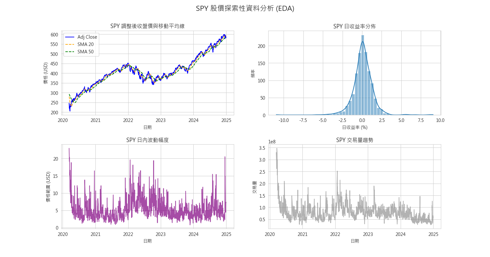

# 股票市場探索性資料分析

本專案使用 Python 從 Yahoo Finance 取得歷史股價資料，示範金融時間序列資料的整理、特徵計算、摘要統計與視覺化。目前預設分析標的是 SPY（SPDR S&P 500 ETF），資料區間為 2020-01-01 至 2024-12-31。

## 專案功能

- 透過 `yfinance` 下載指定股票代號與日期區間的歷史行情。
- 計算調整後收盤價日報酬率、20 日與 50 日簡單移動平均，以及每日高低價差。
- 輸出主要欄位的描述性統計摘要。
- 以圖表呈現調整後收盤價及移動平均線、日報酬分布、每日波動區間與成交量。

## 技術棧

- Python
- Pandas、yfinance
- Matplotlib、Seaborn

依賴套件及版本列於 [`requirements.txt`](requirements.txt)。

## 環境安裝

建議使用 Python 3.11，並在本專案目錄建立獨立的虛擬環境。

### Windows（PowerShell）

```powershell
python -m venv .venv
.\.venv\Scripts\Activate.ps1
python -m pip install --upgrade pip
pip install -r requirements.txt
```

### macOS / Linux

```bash
python3 -m venv .venv
source .venv/bin/activate
python -m pip install --upgrade pip
pip install -r requirements.txt
```

## 使用方式

在專案目錄且已啟用虛擬環境後執行：

```bash
python stock_eda.py
```

程式會連線 Yahoo Finance 下載資料、計算特徵並顯示統計摘要與圖表。若要分析其他標的或調整日期，請修改 `stock_eda.py` 中 `main()` 函式的 `STOCK_TICKER`、`START_DATE` 與 `END_DATE` 設定。

## 執行結果

下圖展示本專案產生的探索性分析圖表。



## 注意事項

- 執行時需要網路連線，以取得 Yahoo Finance 行情資料；資料是否可用亦受資料來源服務影響。
- 若查無指定代號或日期範圍的資料，請確認代號、日期與網路連線。
- 本專案為資料分析與程式實作示範，不構成投資建議。
