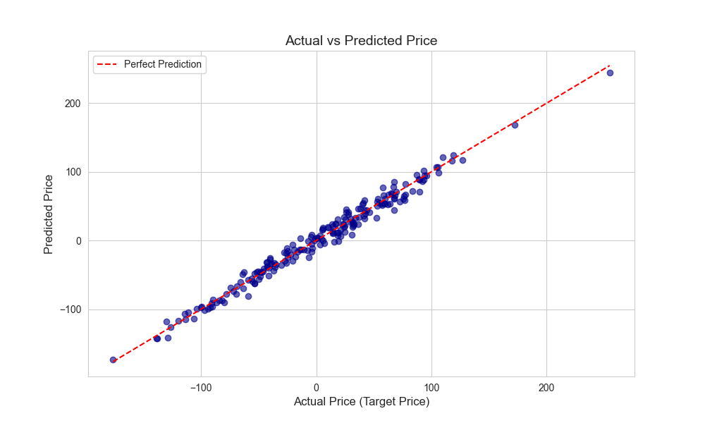
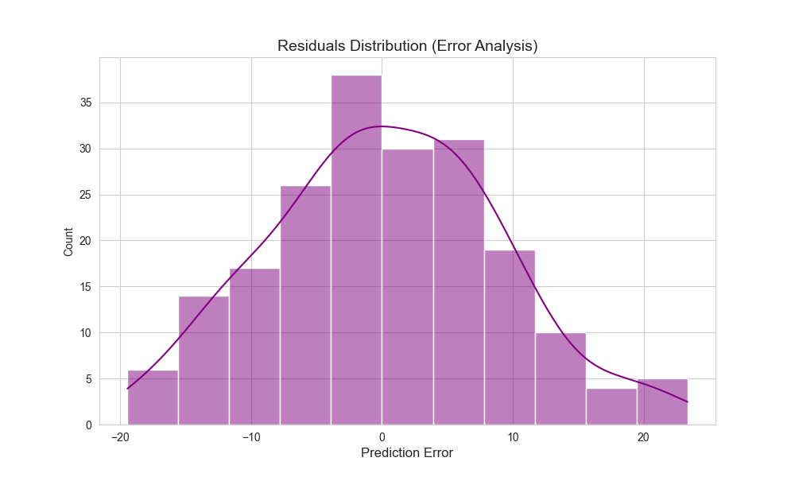

# 線性迴歸機器學習流程

本專案以 Python 與 scikit-learn 示範一套精簡的監督式學習流程：建立迴歸資料、切分訓練與測試集、標準化特徵、訓練線性迴歸模型，並以數值指標和圖表檢視預測表現。

> **資料說明：** 程式使用 `make_regression` 產生合成資料，並非房價或其他實際業務資料。

## 專案功能

- 建立包含 1,000 筆樣本、10 個特徵（其中 5 個具資訊性）的合成迴歸資料。
- 以固定隨機種子切分訓練集與測試集（80%／20%），確保結果可重現。
- 使用 `StandardScaler` 標準化特徵；只在訓練集上擬合縮放器，以避免測試資料洩漏。
- 訓練 `LinearRegression` 模型，並輸出 RMSE 與 R² 評估結果。
- 繪製實際值與預測值散佈圖，以及殘差分布圖。

## 技術棧

- Python
- NumPy、Pandas
- scikit-learn
- Matplotlib、Seaborn

相依套件與版本請參閱 [`requirements.txt`](requirements.txt)。

## 環境安裝

建議使用 Python 3.11，並在專案目錄建立獨立的虛擬環境。

### Windows（PowerShell）

```powershell
python -m venv .venv
.\.venv\Scripts\Activate.ps1
python -m pip install --upgrade pip
pip install -r requirements.txt
```

### macOS / Linux

```bash
python3 -m venv .venv
source .venv/bin/activate
python -m pip install --upgrade pip
pip install -r requirements.txt
```

## 使用方式

在專案目錄且已啟用虛擬環境後執行：

```bash
python ml_regression.py
```

程式會在終端機輸出資料集概況、訓練與測試集大小，以及模型的 RMSE 和 R²；接著開啟預測比較圖和殘差分布圖。若要調整資料特性，可修改 `ml_regression.py` 中 `make_regression` 的參數。

## 執行結果

以下圖表分別呈現測試資料的實際值與預測值，以及模型殘差的分布。

<div align="center">
  
  
</div>

## 評估指標

- **RMSE（均方根誤差）：** 衡量預測值與實際值的平均誤差幅度，數值越低通常代表預測誤差越小。
- **R²（決定係數）：** 衡量模型對目標變異的解釋程度；在此合成資料的設定下，數值越接近 1 通常代表擬合程度越高。

本範例用於展示模型流程與評估方法；合成資料上的結果不代表模型在真實資料上的泛化能力。
