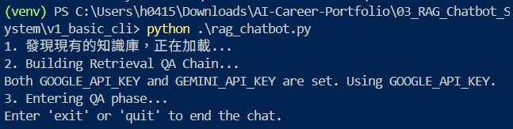
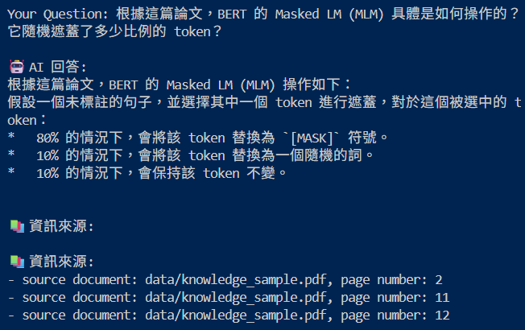
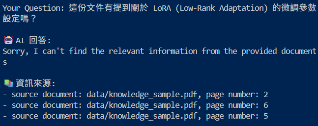

# RAG 文件問答機器人｜CLI 版本

本專案示範以檢索增強生成（Retrieval-Augmented Generation, RAG）建立 PDF 文件問答流程。系統會載入範例 PDF，切分文件、建立向量索引，再依使用者問題檢索相關內容，交由 Gemini 生成回答，並列出參考來源與頁碼。

## 專案功能

- 使用 `PyPDFLoader` 讀取 PDF，並以遞迴文字切分器建立重疊文字區塊。
- 使用本機 Hugging Face 嵌入模型 `sentence-transformers/all-MiniLM-L6-v2` 將文字轉為向量。
- 使用 ChromaDB 建立或載入持久化向量資料庫，預設儲存在 `chroma_db/`。
- 從知識庫檢索最相關的 3 個區塊，並透過 Gemini `gemini-2.5-flash` 生成回答。
- 回答中列出來源文件與頁碼；Prompt 指示模型在文件缺乏足夠資訊時拒絕作答。
- 提供互動式命令列問答，輸入 `exit` 或 `quit` 可結束。

## 技術棧

- Python
- LangChain
- ChromaDB
- Hugging Face Sentence Transformers
- Google Gemini API
- python-dotenv

套件版本請參閱 [`requirements.txt`](requirements.txt)。

## 環境安裝

建議使用 Python 3.11，並在此專案資料夾建立獨立的虛擬環境。

### Windows（PowerShell）

```powershell
python -m venv .venv
.\.venv\Scripts\Activate.ps1
python -m pip install --upgrade pip
pip install -r requirements.txt
```

### macOS / Linux

```bash
python3 -m venv .venv
source .venv/bin/activate
python -m pip install --upgrade pip
pip install -r requirements.txt
```

程式使用 PDF 載入器與 Hugging Face 嵌入模型，`requirements.txt` 未明列這兩項額外套件，請再安裝：

```bash
pip install pypdf sentence-transformers
```

在專案資料夾建立 `.env`，並設定有效的 Gemini API 金鑰：

```env
GEMINI_API_KEY=請填入你的_Gemini_API_Key
```

請勿將含有真實金鑰的 `.env` 提交至版本控制。

## 使用方式

確認 `data/knowledge_sample.pdf` 存在、API 金鑰已設定，並在專案目錄執行：

```bash
python rag_chatbot.py
```

首次執行時，若 `chroma_db/` 尚不存在，程式會讀取 PDF、建立向量索引並保存至該目錄；後續執行會嘗試載入既有索引。啟動後即可輸入問題，輸入 `exit` 或 `quit` 結束對話。

範例問題：

```text
What is the purpose of Masked Language Modeling (MLM) in BERT?
```

## 執行展示

### 1. 系統初始化

啟動時檢查 Gemini API 金鑰並載入或建立 Chroma 向量資料庫。



### 2. 知識問答與來源溯源

根據 BERT 論文內容回答問題，並列出參考文件與頁碼。



### 3. 超出知識範圍的問題

當文件內容無法支持答案時，Prompt 會要求模型說明找不到相關資訊，降低無根據回答的風險。



## 專案結構

```text
v1_basic_cli/
├── README.md
├── rag_chatbot.py
├── requirements.txt
├── data/
│   └── knowledge_sample.pdf
├── chroma_db/              # 持久化向量索引
└── images/                 # 展示截圖
```

## 注意事項

- 生成回答需要網路連線及有效的 Gemini API 金鑰。
- 初次使用本機嵌入模型時，可能會下載模型檔案，請預留網路與磁碟空間。
- 若替換知識文件，請確認 PDF 路徑正確；已有 `chroma_db/` 時，程式會載入現有索引，不會自動偵測來源 PDF 的變更。
- RAG 回答僅供參考，請核對引用來源及原始文件內容。
