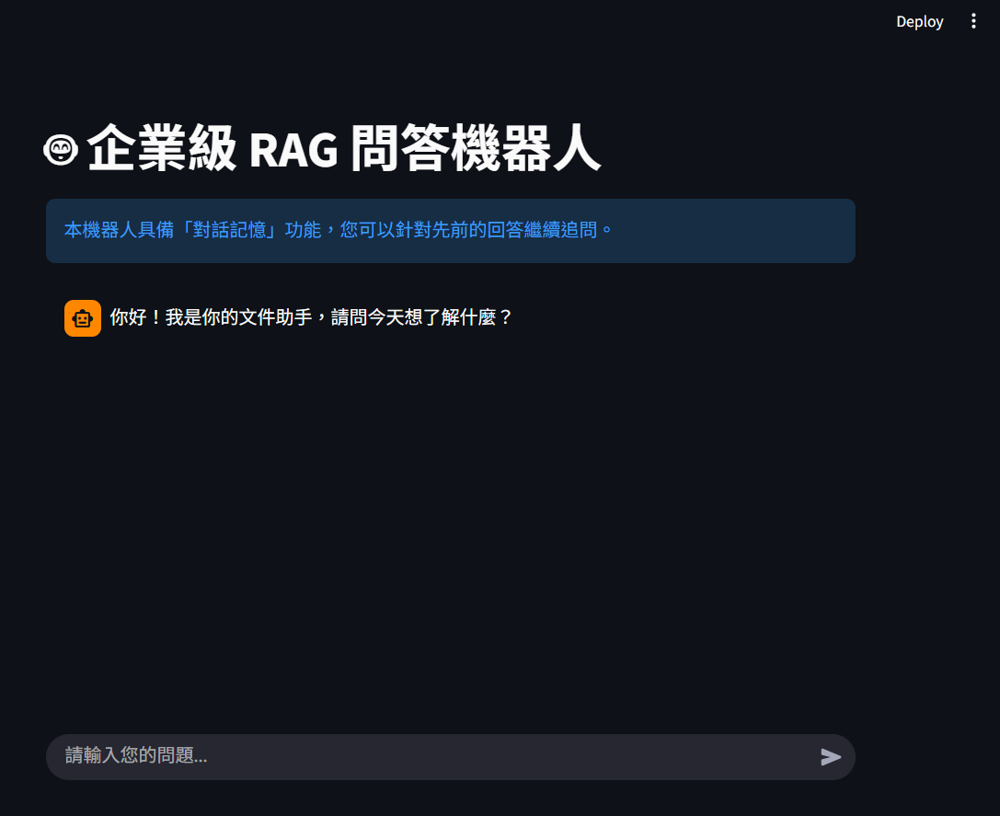
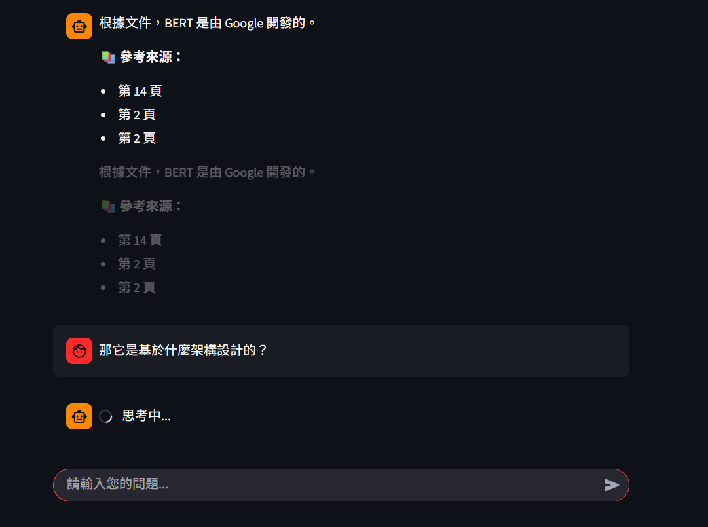
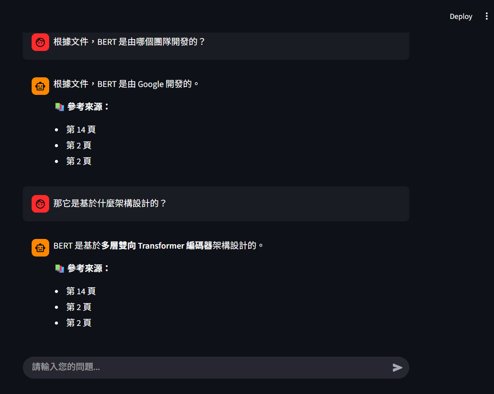
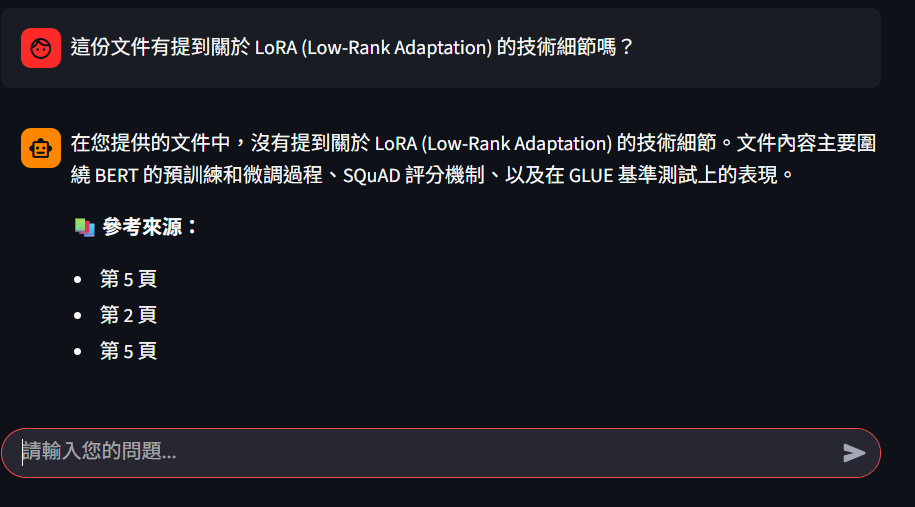

# RAG 文件問答機器人｜Streamlit 版本

本版本將 v1 的 PDF 檢索問答流程改為 Streamlit 網頁應用，並加入短期對話記憶。使用者可透過聊天介面提問、依前文追問，並查看答案所參考的文件頁碼。

## 專案功能

- 使用 Streamlit 提供互動式聊天介面與處理中的提示。
- 載入 `data/knowledge_sample.pdf`，以遞迴文字切分器建立文件區塊。
- 使用本機 Hugging Face 嵌入模型 `sentence-transformers/all-MiniLM-L6-v2`，並以 ChromaDB 持久化向量索引。
- 使用 Gemini `gemini-2.5-flash` 根據檢索內容回答問題。
- 以 `ConversationBufferMemory` 保留目前對話的脈絡，支援多輪追問。
- 回答附上參考來源頁碼；模型回答仍應以原始文件為準。

## 技術棧

- Python、Streamlit
- LangChain
- ChromaDB
- Hugging Face Sentence Transformers
- Google Gemini API、python-dotenv

套件版本請參閱 [`requirements.txt`](requirements.txt)。

## 環境安裝

建議使用 Python 3.11，並在此專案資料夾建立獨立的虛擬環境。

### Windows（PowerShell）

```powershell
python -m venv .venv
.\.venv\Scripts\Activate.ps1
python -m pip install --upgrade pip
pip install -r requirements.txt
```

### macOS / Linux

```bash
python3 -m venv .venv
source .venv/bin/activate
python -m pip install --upgrade pip
pip install -r requirements.txt
```

程式使用 PDF 載入器與 Hugging Face 嵌入模型，`requirements.txt` 未明列這兩項額外套件，請再安裝：

```bash
pip install pypdf sentence-transformers
```

在專案資料夾建立 `.env`，並加入有效的 Gemini API 金鑰：

```env
GEMINI_API_KEY=請填入你的_Gemini_API_Key
```

請勿將含有真實金鑰的 `.env` 提交至版本控制。

## 使用方式

確認 `data/knowledge_sample.pdf` 存在、API 金鑰已設定，並在專案目錄啟動應用程式：

```bash
streamlit run app.py
```

Streamlit 啟動後會在終端機顯示本機網址，使用瀏覽器開啟即可開始對話。首次啟動會建立或載入嵌入模型與向量資料庫；初次下載模型可能需要一些時間。

## 執行展示

### 1. 網頁入口

以 Streamlit 呈現文件問答介面。



### 2. 問答處理狀態

送出問題後，介面會顯示處理提示。



### 3. 多輪對話與來源頁碼

對話鏈保留上下文，回答亦會附上參考頁碼。



### 4. 文件範圍測試

當問題超出文件知識範圍時，應核對回答是否遵循文件內容與提示詞設定。



## 專案結構

```text
v2_streamlit_web/
├── README.md
├── app.py
├── requirements.txt
├── data/
│   └── knowledge_sample.pdf
├── chroma_db/              # 持久化向量索引
└── images/                 # 網頁及功能展示截圖
```

## 注意事項

- 生成回答需要網路連線及有效的 Gemini API 金鑰。
- 首次使用本機嵌入模型時會下載模型檔案，請預留網路與磁碟空間。
- 程式若偵測到既有的 `chroma_db/` 會直接載入；替換 PDF 後，請注意現有索引不會自動更新。
- 對話記憶存在目前 Streamlit 工作階段的問答鏈中；重新啟動或建立新的工作階段後，對話不保證保留。
- RAG 回答可能不完整或有誤，重要資訊請回查引用頁面及原始文件。
