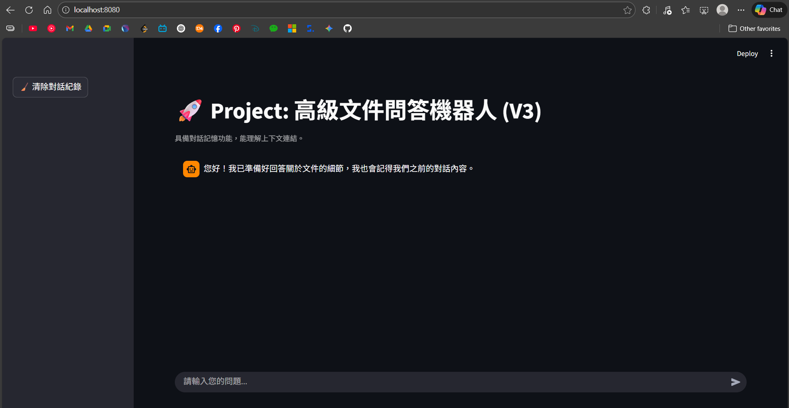
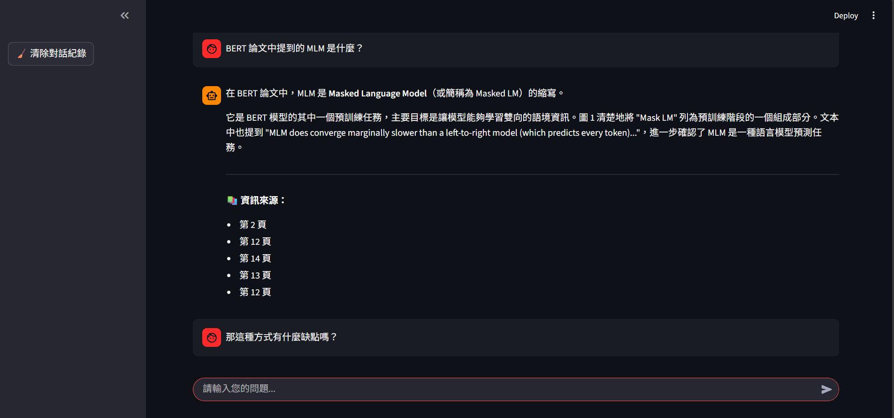
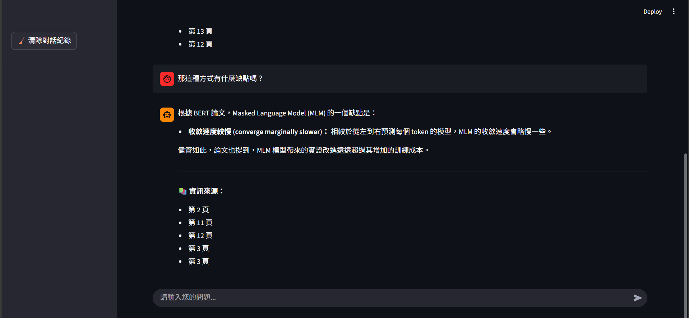
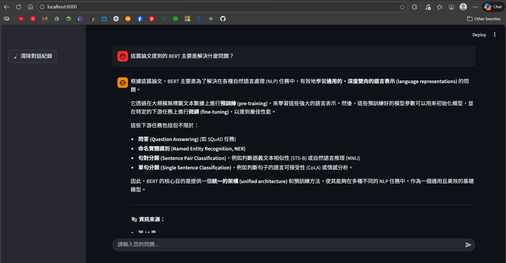
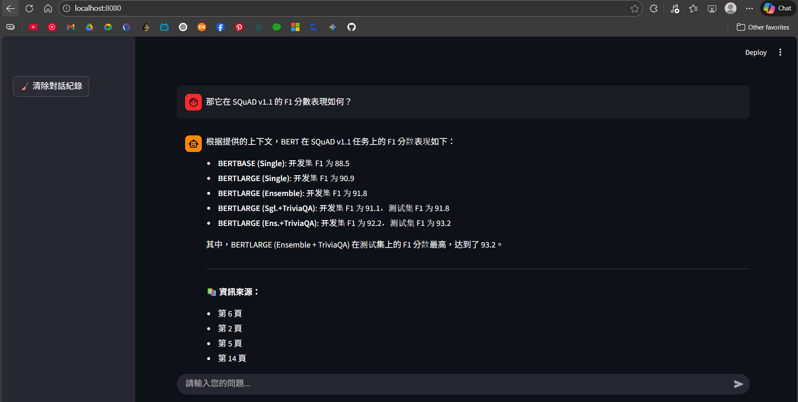
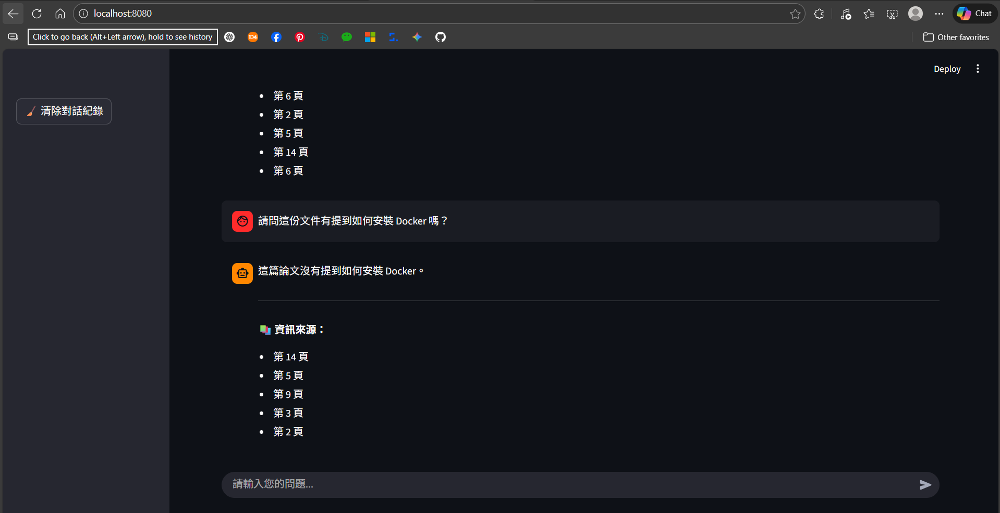
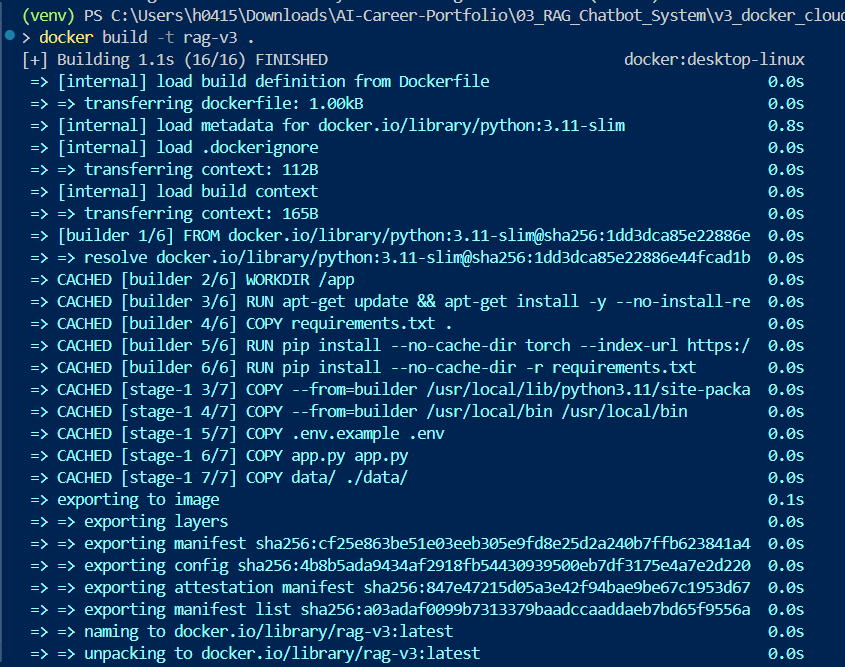
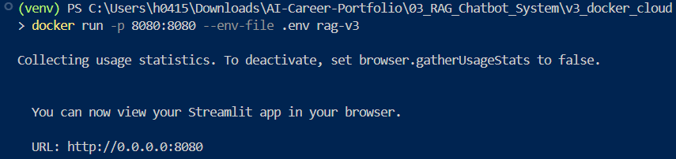

# RAG 文件問答機器人｜Docker 部署版本

本專案是 RAG 文件問答系統的 Streamlit 部署版本，使用 PDF 作為知識來源，透過 ChromaDB 檢索相關內容，再呼叫 Gemini 生成回答。相較 CLI 與一般 Streamlit 版本，本版加入容器化設定、寬版介面、對話記憶及清除對話功能。

## 專案功能

- 使用 Streamlit 提供寬版聊天介面，並支援清除對話紀錄。
- 以 `PyPDFLoader` 讀取 PDF，使用 1,000 字元區塊與 200 字元重疊建立知識索引。
- 使用本機 Hugging Face 嵌入模型 `sentence-transformers/all-MiniLM-L6-v2` 建立 Chroma 向量資料庫。
- 每次提問檢索最多 5 個相關區塊，並由 Gemini `gemini-2.5-flash` 生成回答。
- 使用 `ConversationBufferMemory` 支援同一工作階段中的多輪追問，並顯示來源頁碼。
- 提供 Python 3.11 的多階段 Docker 建置，容器預設以 CPU 版 PyTorch 執行，並在 8080 埠提供服務。

## 技術棧

- Python 3.11、Streamlit
- LangChain、ChromaDB
- Hugging Face Sentence Transformers
- Google Gemini API、python-dotenv
- Docker

套件版本請參閱 [`requirements.txt`](requirements.txt)。

## 必要準備

### Gemini API 金鑰

在專案資料夾建立 `.env`，並填入有效的 API 金鑰：

```env
GEMINI_API_KEY=請填入你的_Gemini_API_Key
```

`.env` 不應提交至版本控制。Docker 映像會將 `.env.example` 複製為容器內的預設 `.env`，但範例值不是有效金鑰；啟動容器時應使用 `--env-file .env` 傳入本機的金鑰。

### PDF 知識文件

應用程式預設讀取 `data/knowledge_sample.pdf`。若複製或下載專案後沒有這個檔案，請提供要索引的 PDF 並放在此路徑。

**Docker 建置注意：** 目前 `.dockerignore` 包含 `*.pdf`，會把 PDF 排除在 Docker 建置內容之外。若要在映像中包含預設知識文件，請在 `.dockerignore` 的 `*.pdf` 規則之後加入例外：

```text
!data/knowledge_sample.pdf
```

確認檔案存在且已納入建置內容後，再執行 Docker 建置。請勿在包含私人文件的情況下無差別開放所有 PDF。

## 環境安裝與本機執行

建議使用 Python 3.11，並在本專案資料夾建立獨立的虛擬環境。

### Windows（PowerShell）

```powershell
python -m venv .venv
.\.venv\Scripts\Activate.ps1
python -m pip install --upgrade pip
pip install -r requirements.txt
```

### macOS / Linux

```bash
python3 -m venv .venv
source .venv/bin/activate
python -m pip install --upgrade pip
pip install -r requirements.txt
```

建立 `.env` 並確認 PDF 路徑正確後，在專案目錄啟動：

```bash
streamlit run app.py
```

## Docker 建置與啟動

在專案目錄準備 `.env` 和 `data/knowledge_sample.pdf`，並依上述說明確認 PDF 已納入 Docker 建置內容。接著執行：

```bash
docker build -t rag-chatbot-v3 .
docker run --rm -p 8080:8080 --env-file .env rag-chatbot-v3
```

在瀏覽器開啟 `http://localhost:8080` 使用應用程式。映像使用兩階段建置，建置階段安裝套件，執行階段複製 Python 套件與應用程式檔案。

> **資料持久性：** Dockerfile 不會複製既有的 `chroma_db/`，容器第一次啟動時會依 PDF 建立索引。索引存在容器可寫入層；使用 `--rm` 停止並移除容器後，索引不會保留，下次啟動可能重新建立。

## 執行展示

### 1. 網頁介面

寬版 Streamlit 介面與側邊欄操作。



### 2. 多輪對話記憶

對話鏈會利用同一工作階段中的上下文理解追問。

**初始問題：** BERT 論文中提到的 MLM 是什麼？



**延伸追問：** 那這種方式有什麼缺點嗎？



### 3. 文件問答與範圍測試

以下畫面展示以文件內容回答問題，以及問題超出文件範圍時的回應。





### 4. Docker 建置與執行




## 專案結構

```text
v3_docker_cloud/
├── README.md
├── Dockerfile
├── .dockerignore
├── .env.example
├── app.py
├── requirements.txt
├── data/
│   └── knowledge_sample.pdf
└── images/                 # 介面、問答及 Docker 展示截圖
```

## 注意事項與限制

- Gemini 回答需要網路連線及有效的 API 金鑰；API 用量可能受供應商配額與計費政策影響。
- 初次執行會下載本機嵌入模型，並可能建立 Chroma 索引，請預留網路、磁碟與記憶體空間。
- 若 `chroma_db/` 已存在，應用程式會載入現有索引；更新 PDF 後需移除或重建舊索引，才會反映新文件內容。
- 對話記憶屬於目前的 Streamlit 工作階段，清除對話或工作階段結束後不保證保留。
- RAG 回答可能不完整或有誤；重要資訊應查閱原始文件及引用頁碼。
