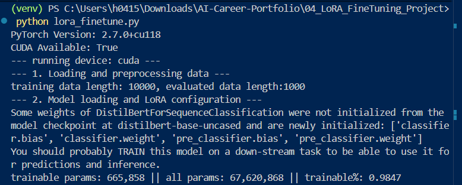
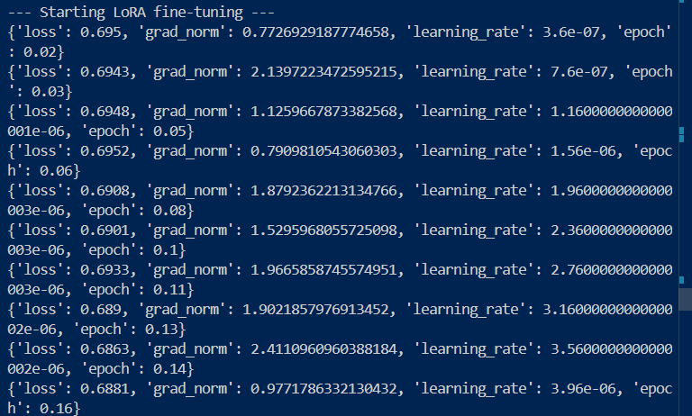
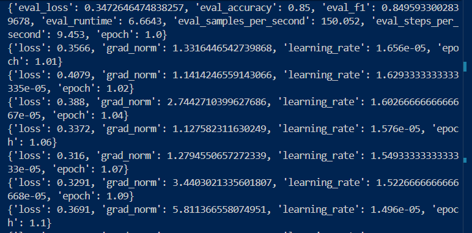
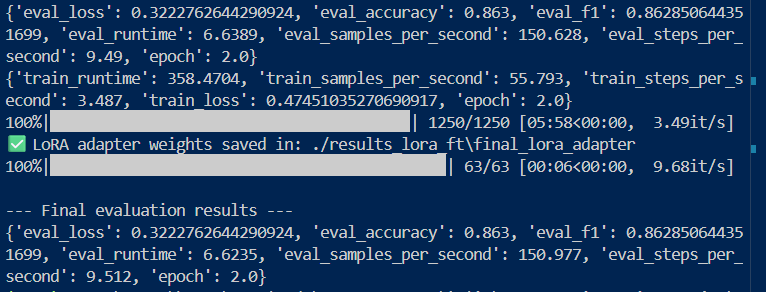
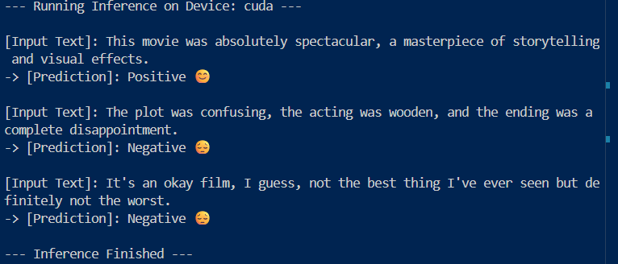

# LoRA 微調電影評論情感分類器

本專案使用參數高效微調（LoRA）將 DistilBERT 調整為 IMDb 電影評論二元情感分類器，並提供命令列推論、Streamlit 網頁介面與 FastAPI 推論 API。微調後的 Adapter 儲存於 `results_lora_ft/final_lora_adapter/`。

## 專案功能

- 使用 Hugging Face Datasets 載入 IMDb 資料集，抽取 10,000 筆訓練資料與 1,000 筆測試資料。
- 在 DistilBERT 的注意力層套用 LoRA，訓練設定為 rank 4，目標模組為 `q_lin` 與 `v_lin`。
- 使用 Transformers Trainer 執行訓練、評估及 Early Stopping，並計算 Accuracy 與 F1。
- 儲存微調後的 LoRA Adapter，以便載入基礎模型進行推論。
- 提供 `lora_inference.py` 命令列範例、`web_gui.py` Streamlit 介面，以及 `app.py` FastAPI API。

專案原始成果紀錄顯示，可訓練參數約占總參數 **0.98%**，IMDb 評估準確率約 **86.3%**。實際結果可能因套件、硬體與執行設定不同而有所差異。

## 技術棧

- Python、PyTorch
- Hugging Face Transformers、Datasets
- PEFT（LoRA）、Accelerate
- scikit-learn
- Streamlit、FastAPI、Uvicorn

依賴套件請參閱 [`requirements.txt`](requirements.txt)。

## 環境安裝

建議使用 Python 3.11，並在專案資料夾建立獨立的虛擬環境。

### Windows（PowerShell）

```powershell
python -m venv .venv
.\.venv\Scripts\Activate.ps1
python -m pip install --upgrade pip
pip install -r requirements.txt
```

### macOS / Linux

```bash
python3 -m venv .venv
source .venv/bin/activate
python -m pip install --upgrade pip
pip install -r requirements.txt
```

若使用 NVIDIA GPU，請依 PyTorch 官方安裝指引選擇與本機 CUDA 相容的 PyTorch 版本。此專案依賴的 `bitsandbytes` 在不同作業系統與硬體上的支援情形可能不同；安裝或訓練遇到問題時，請確認目前環境符合該套件的支援條件。程式會在偵測到 CUDA 時使用 GPU，否則改以 CPU 執行；CPU 訓練可能需要較長時間與較多記憶體。

## 使用方式

### 1. 訓練 LoRA Adapter

在專案目錄執行：

```bash
python lora_finetune.py
```

首次執行會下載 DistilBERT 與 IMDb 資料集。訓練完成後，Adapter 會儲存至 `results_lora_ft/final_lora_adapter/`。訓練資料、模型檔案及輸出結果可能佔用大量網路流量、磁碟與運算資源。

### 2. 命令列推論

確認 `results_lora_ft/final_lora_adapter/` 已存在後執行：

```bash
python lora_inference.py
```

程式會載入 Adapter，並以內建的正面、負面與模糊評論範例進行預測。

### 3. Streamlit 網頁介面

```bash
streamlit run web_gui.py
```

在頁面輸入英文電影評論，即可查看預測情感與信心分數。

### 4. FastAPI 推論服務

```bash
python app.py
```

服務預設監聽 `http://localhost:8000`。使用 `POST /predict`，並以 JSON 傳入評論文字：

```json
{
  "text": "This movie was absolutely fantastic."
}
```

互動式 API 文件可在服務啟動後透過 `http://localhost:8000/docs` 開啟。

## 執行成果

### LoRA 可訓練參數比例



### 訓練紀錄




### IMDb 評估結果



### 推論範例



## 專案結構

```text
04_LoRA_FineTuning_Project/
├── README.md
├── requirements.txt
├── lora_finetune.py       # IMDb 資料前處理與 LoRA 訓練
├── lora_inference.py      # 命令列推論範例
├── web_gui.py             # Streamlit 推論介面
├── app.py                 # FastAPI 推論 API
├── images/                # 訓練、評估與推論截圖
└── results_lora_ft/
    ├── final_lora_adapter/ # 推論所需 Adapter
    ├── checkpoint-*/       # 訓練檢查點（若有）
    └── logs/               # 訓練記錄
```

## 注意事項

- `lora_inference.py`、`web_gui.py` 與 `app.py` 都需要 `results_lora_ft/final_lora_adapter/`；若該資料夾不存在，請先執行訓練或取得相容的 Adapter。
- 推論時仍會下載或載入 DistilBERT 基礎模型；第一次啟動可能需要網路連線。
- 分類結果是模型預測，不應視為對電影品質或評論情緒的絕對判斷。
