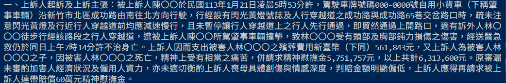
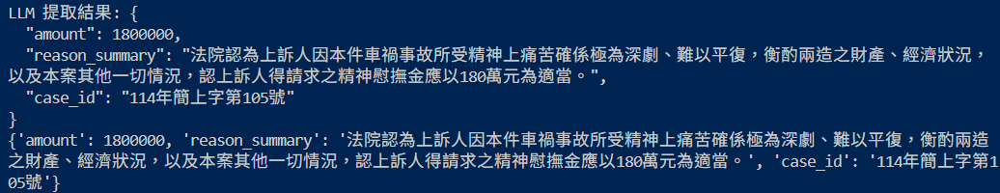
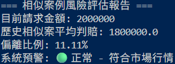

# InsureCheck-AI｜產險判決分析與風險預警原型

本專案示範一套以 Python 建立的判決文字分析流程：從 UTF-8 純文字讀取判決內容，嘗試遮蔽當事人姓名，呼叫本機 Ollama 的 Llama 3 產生結構化分析，再將去識別化文字存入 ChromaDB，並示範相似案例檢索與金額偏離提示。

> **重要說明：** 這是概念驗證原型，不是法律、理賠或資安合規系統。姓名偵測與遮蔽可能不完整，LLM 產生的金額、理由與風險結果必須由專業人員核對。

## 專案功能

- 讀取預先準備的 UTF-8 判決文字，依「主文」及「事實及理由」等標題嘗試切分段落。
- 結合正規表示式與 spaCy 中文 Transformer NER 偵測並遮蔽可能的人名。
- 將去識別化後的判決內容送至 Ollama `llama3`，以 JSON 格式擷取案號、精神慰撫金金額及判決理由摘要。
- 使用 ChromaDB 與 `BAAI/bge-large-zh-v1.5` 嵌入模型儲存案件，並檢索相似案例。
- 以檢索案件金額的平均值作為比較基準；目前範例在申請金額高於該平均值 30% 時標示高風險。

目前程式的風險評估使用固定的示範案情與 2,000,000 元申請金額；這不是可直接用於真實理賠決策的通用評分模型。

## 技術棧

- Python
- spaCy、`zh_core_web_trf`
- Sentence Transformers、`BAAI/bge-large-zh-v1.5`
- ChromaDB
- Ollama、Llama 3
- PyTorch、Transformers

相依套件列於 [`requirement.txt`](requirement.txt)。

## 環境準備與安裝

建議使用 Python 3.10 以上版本及獨立的虛擬環境。

### Windows（PowerShell）

```powershell
python -m venv .venv
.\.venv\Scripts\Activate.ps1
python -m pip install --upgrade pip
pip install -r requirement.txt
python -m spacy download zh_core_web_trf
```

### macOS / Linux

```bash
python3 -m venv .venv
source .venv/bin/activate
python -m pip install --upgrade pip
pip install -r requirement.txt
python -m spacy download zh_core_web_trf
```

另請安裝 Ollama，確認 Ollama 服務正在執行，並下載程式使用的模型：

```bash
ollama pull llama3
```

第一次下載 spaCy Transformer、Sentence Transformers 或 Llama 3 模型會需要網路與額外磁碟空間；Embedding 模型與 PyTorch 也可能使用較多記憶體。

## 準備輸入資料

程式固定讀取：

```text
data/raw_documents/text1.txt
```

請建立或提供此 UTF-8 純文字檔。程式預期判決內容包含「主文」及「事實及理由」等章節標題，並依此擷取表頭、判決主文與理由內容。輸入格式不符合預期時，切分結果可能不完整。

本程式不會自行將 PDF 轉成文字，也不會自動批次處理資料夾中的所有檔案。

## 使用方式

確認 Ollama 服務、`llama3` 模型及輸入文字均已備妥後，在專案目錄執行：

```bash
python insure_check.py
```

執行流程會在終端機列印遮蔽後文本、LLM JSON 擷取結果及相似案例風險報告，並將案件資料寫入 `chroma_db/` 的 `insure_cases` collection。向量資料庫會持續保存在本機；目前使用 ChromaDB `add` 寫入而非更新既有資料，因此相同案號重複匯入時，不會可靠地覆寫原有記錄。

## 執行展示

### 判決文字與去識別化



### LLM 結構化擷取



### 相似案例與風險提示



## 專案結構

```text
05_InsuranceJudgmentAI/
├── README.md
├── insure_check.py
├── requirement.txt
├── data/
│   ├── raw_documents/       # 放置 text1.txt 等 UTF-8 判決文字
│   └── processed_documents/ # 預留的處理資料目錄
├── chroma_db/               # ChromaDB 持久化索引
└── images/                  # 專案展示截圖
```

目前程式主要將分析結果列印至終端機，並不會把去識別化文本另存到 `processed_documents/`。

## 注意事項與限制

- 正規表示式與 NER 可能漏掉姓名或誤判其他文字；請勿因程式有遮蔽功能，就認定文件已完成匿名化或符合任何法規要求。
- 目前主流程只對切分出的「事實及理由」內容執行遮蔽與分析，不保證判決其他段落或欄位中的個資已移除。
- Ollama 模型輸出可能錯誤或格式不完整。判決案號、金額及理由應回查原始判決並由合格人員確認。
- 風險提示是簡化的示範計算，資料量、案件可比性及金額分布都會影響結果，不應單獨用於理賠或法律決策。
- 專案資料可能包含高度敏感的個人資訊；使用前應先取得合法授權並採取適當的存取控制與資料保護措施。
