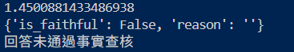
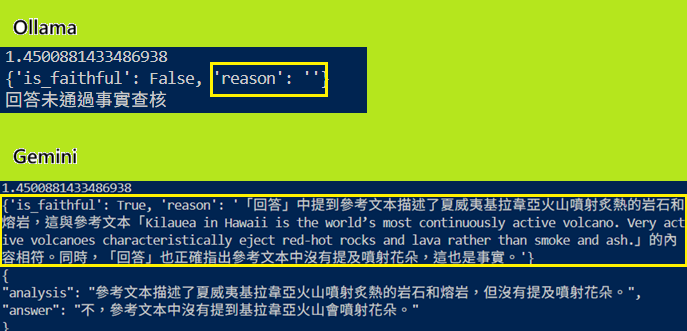

# Modular Self-RAG Agent

本專案以 SciQ 科學問答資料集示範模組化的檢索增強生成（RAG）與自我查核流程。`agent.py` 是主要程式入口，會載入 SciQ 訓練資料前五筆建立記憶體型 ChromaDB collection，再對預設問題執行檢索、回答生成及忠實度查核。這是命令列示範程式，並非互動式聊天介面或部署服務。

## 核心功能

- 以抽象基底類別 `LLMEngine` 定義可替換的語言模型介面。
- 提供 Gemini `gemini-2.5-flash` 與 Ollama `llama3` 引擎；目前預設使用 Gemini。
- 將 SciQ 的 `support` 文字加入向量資料庫，並檢索最相關的一筆內容。
- **相關性檢查：** 向量距離大於程式門檻 `1.5` 時回傳「找不到相關知識」。
- **忠實度查核：** 將生成答案交由 LLM 比對參考文本；若 JSON 查核結果判定不忠實，則拒絕該答案。
- 以 JSON 格式產生回答及查核結果。

這些機制是 LLM 輔助的示範流程，不能保證答案完全正確，也不等同獨立的事實驗證。

## 技術棧

- Python 3.10+
- Hugging Face Datasets（SciQ）
- ChromaDB
- Google Gen AI SDK（Gemini）
- Ollama Python SDK（替代引擎）
- python-dotenv（讀取 Gemini API 金鑰）

套件清單請參閱 [`requirement.txt`](requirement.txt)。

## 環境安裝

建議使用 Python 3.10 以上版本，並在專案資料夾建立獨立虛擬環境。

### Windows（PowerShell）

```powershell
python -m venv .venv
.\.venv\Scripts\Activate.ps1
python -m pip install --upgrade pip
pip install -r requirement.txt
```

### macOS / Linux

```bash
python3 -m venv .venv
source .venv/bin/activate
python -m pip install --upgrade pip
pip install -r requirement.txt
```

在專案資料夾建立或編輯 `.env`，設定自己的 Gemini API 金鑰：

```env
GEMINI_API_KEY=請填入你的_Gemini_API_Key
```

請勿將真實金鑰寫入程式碼或提交 `.env`。

### 改用 Ollama（選用）

安裝並啟動 Ollama，下載模型：

```bash
ollama pull llama3
```

`agent.py` 目前預設使用 Gemini。若要改用 Ollama，請將檔案底部的引擎初始化改為 `OllamaEngine(model_id="llama3")`。

## 執行方式

完成依賴與環境設定後，在專案資料夾執行：

```bash
python agent.py
```

程式首次執行會從 Hugging Face 下載 SciQ 資料集，接著建立小型知識庫並測試程式中的預設問題。若要更換問題，請修改 `agent.py` 的 `query_question`。

向量資料庫使用 `chromadb.Client()` 建立於記憶體中，每次執行都會重新建立，不會持久化到磁碟。範例只使用五筆資料，適合展示流程，不代表完整資料集的檢索效能。

## 執行展示

### Self-RAG 查核流程



### LLM 引擎評估



## 目錄結構

```text
06_Modular_Self_RAG_Agent/
├── README.md
├── agent.py               # RAG Agent 主程式
├── note.txt
├── requirement.txt
├── .env.example
└── images/
    ├── valid_process.png
    └── evaluation.png
```

## 注意事項

- 若未設定 `GEMINI_API_KEY`，Gemini 引擎無法正常呼叫；Gemini 需要網路連線並受供應商配額限制。
- SciQ 首次載入需要網路；若使用 Ollama，請確認服務與 `llama3` 模型已啟動。
- LLM 產生的 JSON 若格式不正確，程式解析可能失敗；相關性門檻與忠實度判斷皆為示範設定。
- 重要回答應回查參考文本，不應只依賴模型的自我查核結果。
